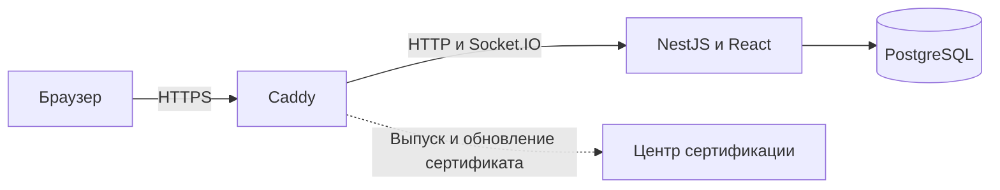
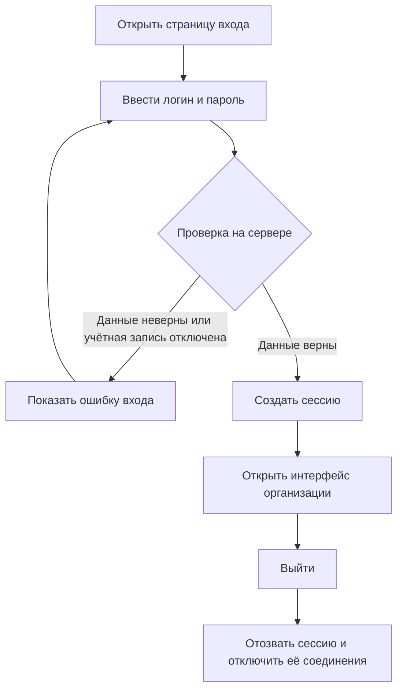

# Decentracord

Decentracord - браузерное приложение для общения внутри одной организации на собственном сервере. Проект находится в разработке: сейчас доступны установка, вход и управление учётными записями. Текстовые каналы и сообщения ещё не реализованы.

## Стек

- TypeScript для клиента и сервера
- React и Vite
- NestJS и Node.js
- PostgreSQL
- Socket.IO
- Docker Compose и Caddy
- Vitest и Playwright для тестирования

## Что уже реализовано

- установка на собственном VPS с HTTPS и автоматическим выпуском сертификата;
- создание первого администратора командой на сервере;
- вход по логину и паролю и сохранение сессии после перезапуска;
- изменение названия организации;
- создание учётных записей сотрудников администратором;
- добровольная смена собственного пароля;
- сброс пароля и отключение учётной записи администратором;
- отзыв сессий и Socket.IO-подключений при выходе, смене пароля, сбросе пароля или отключении учётной записи;
- защита данных организации от неавторизованных пользователей;
- интеграционные и браузерные тесты.

Выданный сотруднику пароль можно использовать сразу. Публичной регистрации и приглашений нет.

## Как устроено приложение



Caddy принимает внешние подключения и передаёт запросы приложению. Приложение и база данных находятся во внутренней сети Docker и не публикуют свои порты. Браузер загружает интерфейс с сервера установки, без внешних шрифтов и CDN. Caddy обращается к центру сертификации для выпуска и обновления HTTPS-сертификата.

### Вход в приложение



## Структура проекта

```text
apps/
  server/src/       сервер, авторизация и управление учётными записями
  web/src/          браузерный интерфейс
migrations/         миграции PostgreSQL
deploy/             конфигурация Caddy
docs/               инструкция по установке
scripts/            проверки установки и тестового HTTPS
tests/              интеграционные и браузерные тесты
compose.yaml        сервисы приложения, базы и прокси
Dockerfile          сборка приложения и тестовых образов
```

## Установка на VPS

Понадобятся Linux-сервер с Docker Engine и Docker Compose 2.17 или новее, домен с A-записью на IP сервера и доступные извне TCP-порты 80 и 443. UDP-порт 443 можно открыть для HTTP/3.

1. Скопируйте проект на сервер и перейдите в его каталог.
2. Создайте `.env` из примера и укажите домен и адрес приложения:

   ```bash
   cp .env.example .env
   ```

   В файле задайте `PUBLIC_HOST` и соответствующий `APP_ORIGIN`, например `chat.example.com` и `https://chat.example.com`.

3. Создайте файл с паролем базы данных:

   ```bash
   mkdir -p ./secrets
   chmod 700 ./secrets
   umask 077
   openssl rand -hex 32 | tr -d '\n' > ./secrets/db_password
   chmod 600 ./secrets/db_password
   sudo chown 1000:1000 ./secrets/db_password
   ```

4. Проверьте конфигурацию и запустите контейнеры:

   ```bash
   docker compose -f compose.yaml config --quiet
   docker compose -f compose.yaml up -d --build --wait
   ```

5. Создайте первого администратора, заменив `LOGIN` на нужный логин. Команда запросит пароль в терминале:

   ```bash
   docker compose -f compose.yaml exec -it app node apps/server/dist/cli.js bootstrap-admin --login LOGIN
   ```

После выпуска сертификата откройте `https://<PUBLIC_HOST>` и войдите под созданной учётной записью. Администратор может создавать остальных пользователей в интерфейсе.

Подробные требования, настройки, команды проверки и описание секретов находятся в [инструкции по установке](docs/installation.md). Демо-аккаунт по умолчанию не создаётся.

## Миграции

Миграции базы данных находятся в каталоге `migrations/` и применяются при запуске приложения. Команда для отдельного запуска миграций:

```bash
npm run db:migrate
```

Для этой команды нужны Docker Compose и настроенный `.env` с доступным файлом секрета.

## Тесты

Для локальной сборки и запуска проверок нужен Node.js 26.13 или новее в пределах версии 26. Интеграционные и браузерные тесты используют Docker Compose.

```bash
npm ci
npm run build
npm run lint
npm run typecheck
npm run test:integration
npm run test:e2e
```

Проверка установки и сессий через изолированный HTTPS-стенд:

```bash
node scripts/test-tls.mjs --project decentracord-tls-check \
  --spec tests/e2e/tls-session.spec.ts \
  --spec tests/e2e/installation-privacy.spec.ts
```

## Что дальше

Планируется добавить управление ролями и закрытыми каналами, затем переписку с историей сообщений. Резервное копирование и восстановление установки также требуют отдельной реализации и проверки.
