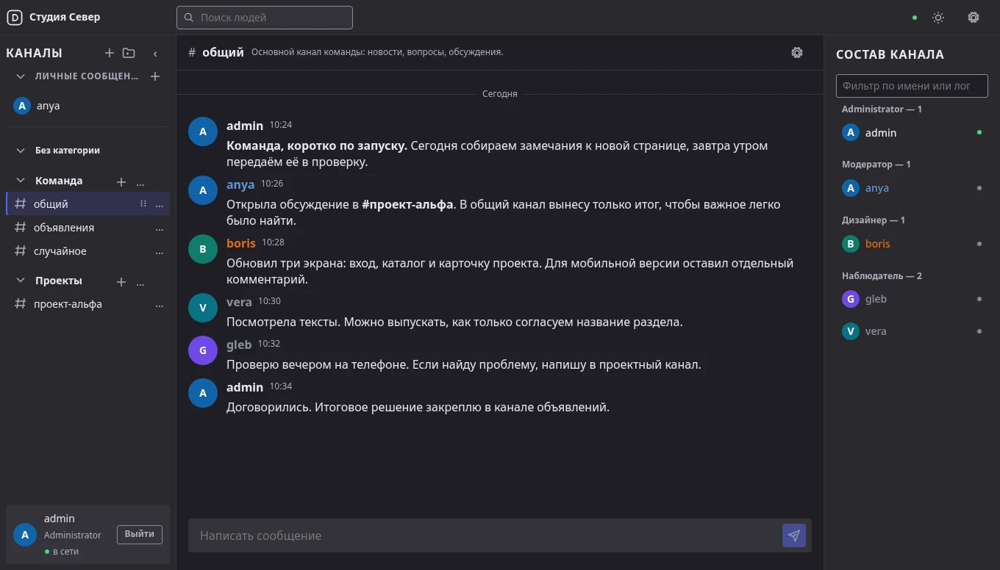
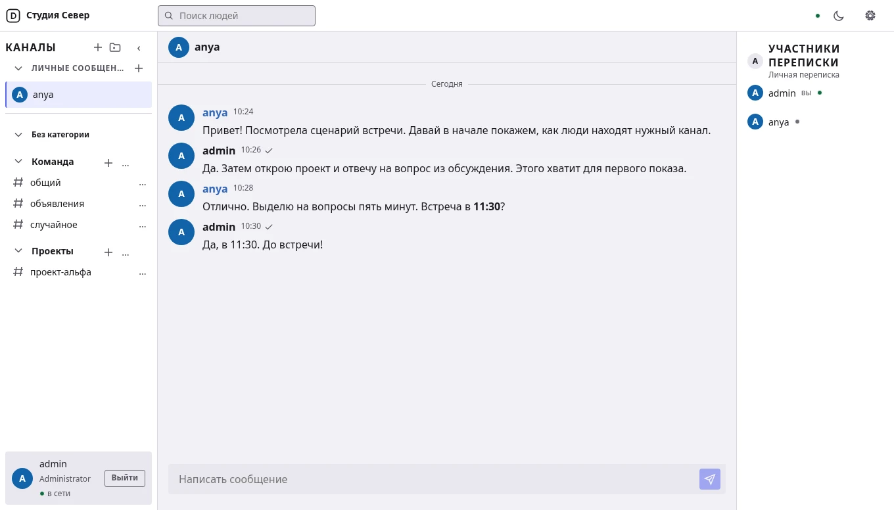
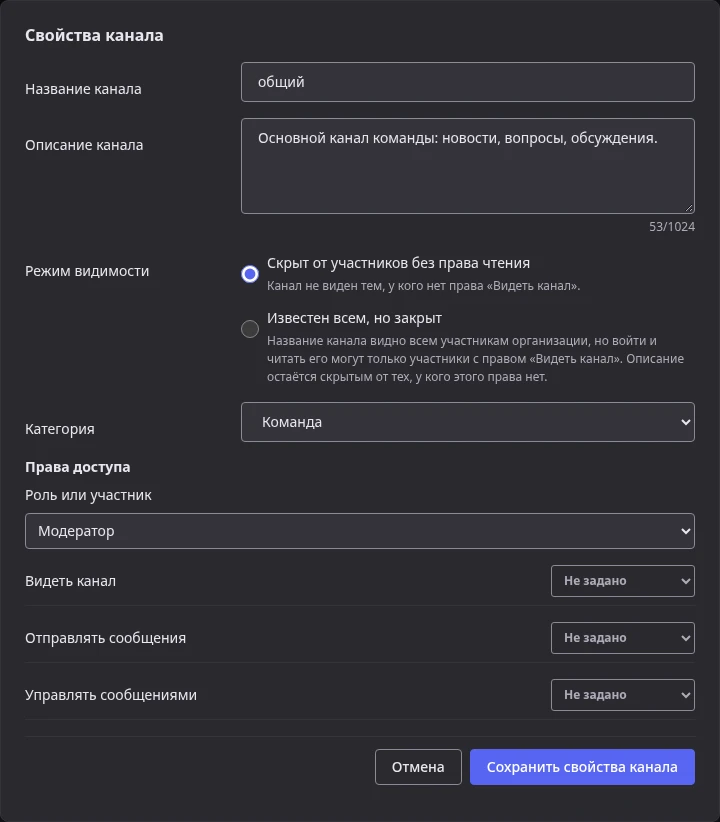
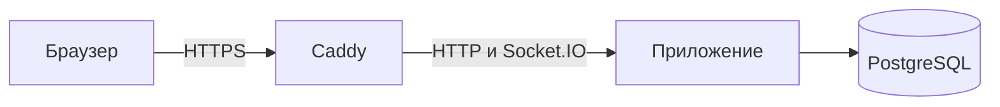

# Decentracord

Decentracord — браузерный мессенджер для команды на собственном сервере. Общайтесь в каналах и личных переписках, разделяйте доступ по ролям и управляйте учётными записями в одном интерфейсе.



## Возможности

- **Каналы.** Категории, закрытые каналы, каналы только для чтения и отдельные разрешения для ролей и участников.
- **Переписка.** Личные и групповые сообщения, история, непрочитанные сообщения и индикатор набора текста в личных переписках.
- **Работа с сообщениями.** Markdown, упоминания, редактирование, пересылка и закрепления в каналах.
- **Управление командой.** Учётные записи создаёт администратор. Он назначает роли, сбрасывает пароли и отключает доступ.
- **Собственная установка.** Интерфейс и данные обслуживаются вашим сервером. Браузер загружает ресурсы приложения с этого же сервера.

### Интерфейс

**Личная переписка в светлой теме**



**Настройка прав канала**



На скриншотах используются демонстрационные данные.

## Установка на VPS

Понадобятся Linux-сервер с Docker Engine и Docker Compose 2.17 или новее, домен с A-записью на IP сервера и доступные извне TCP-порты 80 и 443. UDP-порт 443 можно открыть для HTTP/3.

1. Скопируйте проект на сервер и перейдите в его каталог. Создайте конфигурацию:

   ```bash
   cp .env.example .env
   ```

   В `.env` укажите домен в `PUBLIC_HOST` и полный HTTPS-адрес в `APP_ORIGIN`, например `chat.example.com` и `https://chat.example.com`.

2. Создайте файл с паролем PostgreSQL:

   ```bash
   mkdir -p ./secrets
   chmod 700 ./secrets
   umask 077
   openssl rand -hex 32 | tr -d '\n' > ./secrets/db_password
   chmod 600 ./secrets/db_password
   sudo chown 1000:1000 ./secrets/db_password
   ```

3. Проверьте конфигурацию и запустите сервисы:

   ```bash
   docker compose -f compose.yaml config --quiet
   docker compose -f compose.yaml up -d --build --wait
   ```

4. Создайте первого администратора, подставив логин вместо `LOGIN`. Команда запросит пароль:

   ```bash
   docker compose -f compose.yaml exec -it app node apps/server/dist/cli.js bootstrap-admin --login LOGIN
   ```

Откройте адрес из `APP_ORIGIN` после выпуска сертификата. Войдите под созданной учётной записью и добавьте участников в настройках. Подробности приведены в [руководстве по установке](docs/installation.md).

## Архитектура



Приложение использует React и Vite на клиенте, NestJS и Socket.IO на сервере. Caddy принимает HTTPS и управляет сертификатом. Приложение и PostgreSQL работают во внутренней сети Docker Compose.

| Каталог | Содержимое |
| --- | --- |
| `apps/web` | Браузерный интерфейс |
| `apps/server` | API, сессии, разрешения и доставка сообщений |
| `migrations` | Миграции PostgreSQL, применяемые при запуске |
| `deploy` | Конфигурация прокси |
| `tests` | Интеграционные и браузерные тесты |

## Проверки

Для локальной сборки нужен Node.js 26.13 или новее в пределах версии 26. Для интеграционных и браузерных тестов понадобится Docker Compose.

```bash
npm ci
npm run typecheck
npm run lint
npm run build
npm run test:integration
npm run test:e2e
```
